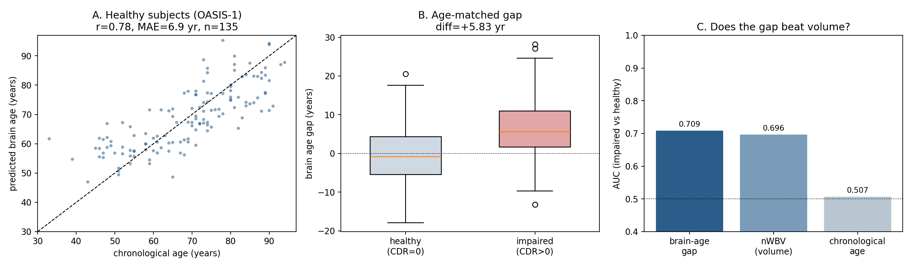
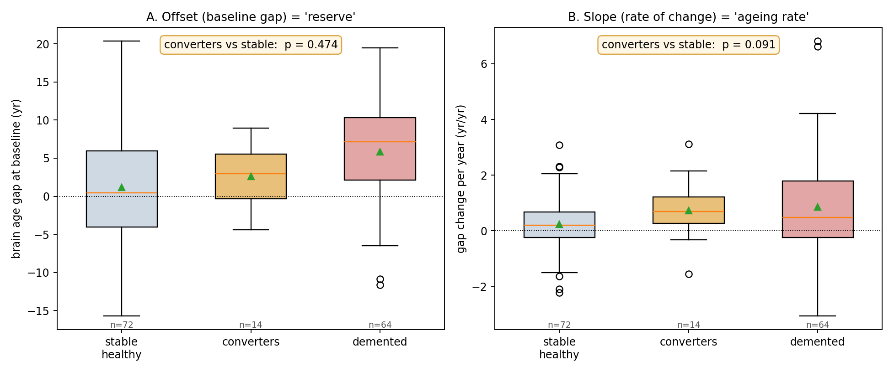
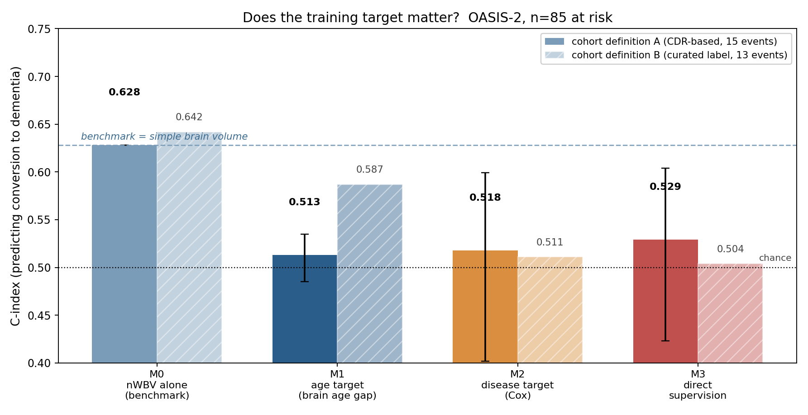
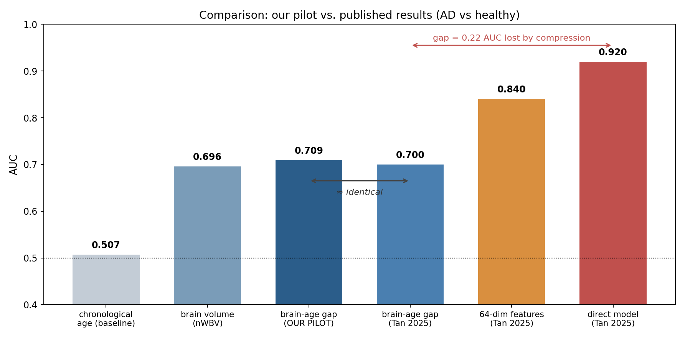

# لبه‌ی علم در تخمین سن مغز، و نتایج پیاده‌سازی اولیه

این گزارش دو بخش دارد. در بخش نخست، بر اساس مقالات داوری‌شده‌ی سال‌های اخیر نشان می‌دهیم که پرسش اصلی این حوزه امروز چیست. در بخش دوم، یک پیاده‌سازی اولیه روی داده‌ی واقعی انجام داده‌ایم، نتایج آن را گزارش می‌کنیم، و آن‌ها را با اعداد منتشرشده در ادبیات مقایسه می‌کنیم. در پایان، خلأ پژوهشی شناسایی‌شده و مسیر پیشنهادی برای ادامه‌ی کار ارائه می‌شود.

---

## بخش ۱: لبه‌ی علم — سه یافته‌ای که مسیر این حوزه را عوض کرده‌اند

تا چند سال پیش، تصور عمومی در این حوزه آن بود که هرچه مدلِ تخمین سن دقیق‌تر شود، تشخیص بیماری نیز بهتر خواهد شد. سه مقاله‌ی اخیر نشان داده‌اند که این تصور درست نیست. این سه مقاله امروز لبه‌ی علم را تعریف می‌کنند.

### ۱-۱ فشرده‌کردن مغز در یک عدد، اطلاعات زیادی را از بین می‌برد

مقاله‌ی Tan و همکاران (۲۰۲۵، مجله‌ی Human Brain Mapping) روی سه دیتاست ADNI، AIBL و MACC انجام شد. نویسندگان یک مدل از پیش آموزش‌دیده‌ی سن مغز (آموزش‌دیده روی ۵۳٬۵۴۲ نفر) را برداشتند و آن را با مدلی مقایسه کردند که مستقیماً برای تشخیص آلزایمر آموزش دیده بود. نتیجه به این شرح بود:

| روش | AUC در تشخیص آلزایمر |
|---|---|
| شکاف سن مغز، به‌صورت یک عدد اسکالر | ۰٫۷۰ |
| ویژگی‌های ۶۴-بعدی همان شبکه | ۰٫۸۴ |
| مدل مستقیم، بدون استفاده از سن مغز | ۰٫۹۲ |

جمله‌ی صریح نویسندگان این است که «خلاصه‌کردن سن مغز در یک عدد اسکالر منجر به عملکرد پیش‌بینی ضعیف شد» و اینکه «استفاده از سن تقویمی به‌عنوان هدف پیش‌آموزش ممکن است برای پیش‌بینی پیامدهای سلامتی مشخص بهینه نباشد».

### ۱-۲ دقت بیشتر در تخمین سن، لزوماً به تشخیص بهتر بیماری منجر نمی‌شود

مقاله‌ی Schulz، Siegel و Ritter (۲۰۲۵، مجله‌ی PLOS Biology) روی ۴۶٬۳۸۱ نفر از UK Biobank نشان داد که رابطه‌ای **معکوس** میان دقت پیش‌بینی سن و حساسیت به بیماری وجود دارد. یک رگرسیون ریج با حدود ۱٬۴۰۰ پارامتر بیشترین اندازه‌ی اثر را در تشخیص بیماری داشت، در حالی که یک شبکه‌ی ResNet-50 با ۴۶٫۲ میلیون پارامتر دقیق‌ترین تخمین سن را ارائه می‌داد اما ضعیف‌ترین حساسیت به بیماری را داشت.

دلیل این پدیده روشن است: مدل‌های بسیار دقیق، ویژگی‌های ریزی را می‌آموزند که مختص پیری طبیعی‌اند و ربطی به آسیب‌شناسی بیماری ندارند. در مقابل، مدل‌های ساده‌تر ناچار می‌شوند به معیارهای کلی‌تری مانند حجم کل ماده‌ی خاکستری تکیه کنند که تغییرات منتشر ناشی از بیماری را بهتر بازتاب می‌دهند.

### ۱-۳ شکاف سن مغز در یک مقطع، سرعت پیری را اندازه نمی‌گیرد

مقاله‌ی Vidal-Piñeiro و همکاران (۲۰۲۱، مجله‌ی eLife) با استفاده از هزاران فرد دارای اسکن‌های مکرر نشان داد که شکاف سن مغز در یک مقطع زمانی، هیچ ارتباطی با سرعت واقعی تغییر مغز در طول زمان ندارد. در عوض، این شکاف با وزن هنگام تولد و عوامل اوایل زندگی مرتبط است.

به عبارت دیگر، بخش بزرگی از آنچه شکاف سن مغز اندازه می‌گیرد **ذخیره‌ی مغزی** است، نه **سرعت پیری مغز**. این دو مفهوم کاملاً متفاوت‌اند: فردی ممکن است از ابتدا مغز کوچک‌تری داشته باشد بدون آنکه در حال تخریب باشد، و فردی دیگر ممکن است مغز بزرگی داشته باشد که به‌سرعت در حال تحلیل رفتن است.

### ۱-۴ جمع‌بندی: پرسش امروز چیست؟

از کنار هم گذاشتن این سه مقاله یک نتیجه حاصل می‌شود: **مسأله‌ی اصلی این حوزه دیگر دقت نیست.** چارچوب سن مغز دو تصمیم را در خود پنهان کرده است:

۱. **هدف آموزش**، که سن تقویمی است.
۲. **میزان فشرده‌سازی**، که یک عدد اسکالر است.

وقتی این چارچوب در پیش‌بینی بیماری ضعیف عمل می‌کند، نمی‌دانیم کدام‌یک از این دو مقصر است. در بخش ۴ به این نکته باز خواهیم گشت.

---

## بخش ۲: پیاده‌سازی اولیه — داده و روش

پیش از هر ادعایی، لازم بود خودمان روی داده‌ی واقعی نتیجه بگیریم و ببینیم آیا آنچه در ادبیات گفته می‌شود قابل بازتولید است یا خیر.

### ۲-۱ داده‌ها

از دیتاست **OASIS** استفاده کردیم که آزادانه در دسترس است و نیازی به درخواست و امضای توافق‌نامه ندارد:

| دیتاست | نوع | حجم | ترکیب |
|---|---|---|---|
| OASIS-1 | مقطعی | ۴۳۶ فرد، ۳۳ تا ۹۴ سال | ۱۳۵ نفر سالم (CDR=0)، ۱۰۰ نفر دارای اختلال شناختی (CDR>0) |
| OASIS-2 | طولی | ۱۵۰ فرد، ۳۷۳ جلسه | ۷۲ نفر سالم پایدار، ۶۴ نفر مبتلا، **۱۴ نفر تبدیل‌شونده به دمانس** |

گروه تبدیل‌شونده در OASIS-2 برای ما ارزش ویژه‌ای دارد، زیرا این افراد در ابتدای مطالعه سالم بوده‌اند و در طول زمان به دمانس مبتلا شده‌اند.

### ۲-۲ روش

ویژگی‌های ورودی عبارت‌اند از حجم نرمال‌شده‌ی کل مغز (nWBV)، حجم تخمینی داخل جمجمه (eTIV) و جنسیت. یک مدل رگرسیون خطی **فقط روی افراد سالم** آموزش داده شد و هدف آموزش، سن تقویمی فرد بود. سپس همان مدل روی افراد بیمار اعمال و شکاف سن مغز محاسبه شد.

دو نکته‌ی روش‌شناختی رعایت شد که اهمیت زیادی دارند:

**نخست، تصحیح سوگیری رگرسیونی.** مدل‌های سن مغز به‌سمت میانگین بازمی‌گردند؛ یعنی سن افراد جوان را بیش‌برآورد و سن افراد مسن را کم‌برآورد می‌کنند. این باعث می‌شود شکاف سنی به‌طور مصنوعی با سن همبستگی پیدا کند. شیب این سوگیری اندازه‌گیری شد (۰٫۳۷۲- سال به‌ازای هر سال) و تصحیح گردید. این تصحیح فقط بر اساس افراد سالم و فقط با پیش‌بینی‌های خارج از فولد برآورد شد تا نشت اطلاعات رخ ندهد.

**دوم، تطبیق سنی.** افراد بیمار در این دیتاست همگی بالای ۶۲ سال هستند، در حالی که افراد سالم از ۳۳ سالگی شروع می‌شوند. اگر این دو گروه مستقیماً مقایسه شوند، اختلاف سن خودش را به‌جای اثر بیماری نشان می‌دهد. بنابراین مقایسه به افراد بالای ۶۲ سال محدود شد؛ پس از آن میانگین سنی دو گروه عملاً یکسان شد (۷۶٫۷ در برابر ۷۶٫۸ سال).

---

## بخش ۳: نتایج

### ۳-۱ خلاصه‌ی نتایج در یک نگاه

| # | پرسش | نتیجه |
|---|---|---|
| ۱ | آیا می‌توان سن را از روی ساختار مغز تخمین زد؟ | بله. همبستگی ۰٫۷۸، خطای ۶٫۹ سال |
| ۲ | آیا مغز بیماران پیرتر به‌نظر می‌رسد؟ | بله. **۵٫۸۳+ سال**، با معناداری بالا |
| ۳ | آیا شکاف سن مغز از حجم ساده‌ی مغز بهتر است؟ | **خیر.** AUC ۰٫۷۰۹ در برابر ۰٫۶۹۶ |
| ۴ | آیا سرعت پیری، افراد در معرض خطر را جدا می‌کند؟ | بله، سرعت جدا می‌کند؛ نقطه‌ی شروع خیر |
| ۵ | آیا تغییر هدف آموزش نتیجه را بهتر می‌کند؟ | در این مقیاس خیر؛ و **هیچ مدلی از حجم مغز بهتر نبود** |

در ادامه هر یک از این پنج نتیجه توضیح داده می‌شود. نتایج یک تا چهار مربوط به ارزیابی چارچوب موجودند و نتیجه‌ی پنجم حاصل آزمایشی است که خودمان طراحی کرده‌ایم.

### ۳-۲ نتیجه‌ی اول و دوم: بازتولید یافته‌ی بنیادین

به شکل ۱ دقت فرمایید.

در قسمت **A** رابطه‌ی میان سن تخمین‌زده‌شده و سن واقعی برای افراد سالم نشان داده شده است. همبستگی برابر با **۰٫۷۸** و میانگین خطای مطلق برابر با **۶٫۹ سال** به‌دست آمد.

در قسمت **B** شکاف سن مغز برای دو گروه تطبیق‌سنی‌شده آمده است:

- افراد سالم: **۰٫۰۲- سال** (یعنی عملاً صفر، همان‌طور که انتظار می‌رود)
- افراد دارای اختلال شناختی: **۵٫۸۱+ سال**
- اختلاف: **۵٫۸۳+ سال**، اندازه‌ی اثر ۰٫۷۶، و p برابر با ۴×۱۰⁻⁷

نکته‌ی مهم این است که مدل ما هرگز یک مغز بیمار ندیده بود. این مدل فقط یاد گرفته بود مغز سالم در هر سنی چه شکلی است، و صرفاً بر همین اساس، مغز بیماران را حدود شش سال پیرتر از سن واقعی‌شان تخمین زد. این دقیقاً همان یافته‌ای است که این حوزه بر پایه‌ی آن بنا شده است.

### ۳-۳ نتیجه‌ی سوم: آیا شکاف سن مغز از حجم ساده‌ی مغز بهتر است؟

این مهم‌ترین بخش کار ماست. پرسش این است: حالا که شکاف سن مغز بیماران را از سالم‌ها جدا می‌کند، آیا این کار را بهتر از یک اندازه‌گیری ساده‌ی حجم مغز انجام می‌دهد؟ به قسمت **C** از شکل ۱ دقت فرمایید.

| معیار | AUC |
|---|---|
| شکاف سن مغز | ۰٫۷۰۹ |
| حجم نرمال‌شده‌ی مغز، به‌تنهایی | ۰٫۶۹۶ |
| سن تقویمی | ۰٫۵۰۷ |

اختلاف میان شکاف سن مغز و حجم مغز برابر با **۰٫۰۱۲+** با بازه‌ی اطمینان ۹۵ درصد `[-0.035, +0.061]` و **p برابر با ۰٫۶۵** است.

به عبارت دیگر، **شکاف سن مغز هیچ برتری معناداری بر اندازه‌گیری ساده‌ی حجم مغز ندارد.** تمام فرآیند آموزش مدل، تصحیح سوگیری و محاسبه‌ی شکاف، در عمل چیزی بیش از آنچه یک عدد ساده‌ی حجم مغز می‌گفت به ما نداد.

### ۳-۴ نتیجه‌ی چهارم: تفکیک «ذخیره» از «سرعت»

در بخش ۱-۳ اشاره شد که شکاف مقطعی بیشتر بازتاب ذخیره‌ی مغزی است تا سرعت پیری. این ادعا را روی داده‌ی طولی OASIS-2 آزمودیم. برای هر فرد دو کمیت محاسبه شد:

- **مبدأ**: شکاف سنی در نخستین اسکن، که نماینده‌ی **ذخیره** است.
- **شیب**: نرخ تغییر سالانه‌ی شکاف، که نماینده‌ی **سرعت پیری** است.

به شکل ۲ دقت فرمایید.

| گروه | تعداد | مبدأ (سال) | شیب (سال بر سال) |
|---|---|---|---|
| سالم پایدار | ۷۲ | ۱٫۱۹+ | **۰٫۲۴+** |
| تبدیل‌شونده به دمانس | ۱۴ | ۲٫۵۹+ | **۰٫۷۳+** |
| مبتلا | ۶۴ | ۵٫۸۱+ | ۰٫۸۶+ |

نکته‌ی مهم در مقایسه‌ی دو گروه اول است. افرادی که بعداً به دمانس مبتلا شدند، مغزشان با سرعتی حدود **سه برابر** سریع‌تر از افراد سالم پیر می‌شد. اما توجه بفرمایید که کدام کمیت این دو گروه را از هم جدا می‌کند:

- **مبدأ** (ذخیره): p برابر با ۰٫۴۷ — هیچ تفکیکی صورت نمی‌گیرد.
- **شیب** (سرعت): p برابر با ۰٫۰۹ — در آستانه‌ی معناداری و در جهت درست.

به عبارت دیگر، **سرعت تغییر تفکیک می‌کند، اما نقطه‌ی شروع نمی‌کند.** علت معنادار نشدن، تعداد بسیار کم گروه تبدیل‌شونده (تنها ۱۴ نفر) است. در دیتاست ADNI این گروه حدود ۳۰۰ نفر خواهد بود.

### ۳-۵ نتیجه‌ی پنجم: آیا هدف آموزش اهمیت دارد؟

سه نتیجه‌ی قبلی مربوط به بازتولید و ارزیابی چارچوب موجود بود. در این بخش یک آزمایش جدید طراحی و اجرا کردیم که مستقیماً به پرسش اصلی این حوزه می‌پردازد: **آیا مشکل، هدفِ آموزش است؟**

**طراحی آزمایش.** چهار مدل ساختیم که همگی **ورودی یکسان** (حجم نرمال‌شده‌ی مغز، حجم داخل جمجمه، جنسیت)، **افراد یکسان** و **تقسیم‌بندی داده‌ی یکسان** دارند. تنها چیزی که تغییر می‌کند، هدف آموزش است:

| مدل | هدف آموزش |
|---|---|
| M0 | بدون آموزش — فقط حجم مغز به‌عنوان معیار مبنا |
| M1 | سن تقویمی، سپس محاسبه‌ی شکاف (چارچوب استاندارد سن مغز) |
| M2 | زمان تا تبدیل به دمانس، با مدل Cox و در نظر گرفتن سانسور داده |
| M3 | برچسب تبدیل، به‌صورت مستقیم |

نکته‌ی مهم در طراحی این است که **سن تقویمی عمداً به‌عنوان ویژگی ورودی به هیچ مدلی داده نشده است**؛ در غیر این صورت مدل‌های M2 و M3 مزیت ناعادلانه‌ای نسبت به چارچوب سن مغز پیدا می‌کردند.

**جمعیت مورد مطالعه.** ۸۵ نفر از OASIS-2 که در ابتدای مطالعه دمانس نداشتند، با **۱۵ رویداد تبدیل** و میانه‌ی پیگیری ۲٫۸۷ سال. معیار ارزیابی، شاخص همخوانی (C-index) برای پیش‌بینی زمان تبدیل است. برای اطمینان از پایداری نتیجه، کل آزمایش با دو تعریف متفاوت از «تبدیل» تکرار شد (یکی بر اساس نمره‌ی CDR و دیگری بر اساس برچسب خودِ دیتاست). به شکل ۴ دقت فرمایید.

| مدل | C-index (تعریف اول) | C-index (تعریف دوم) |
|---|---|---|
| M0 — حجم مغز به‌تنهایی | **۰٫۶۲۸** | **۰٫۶۴۲** |
| M1 — هدف: سن تقویمی | ۰٫۵۱۳ | ۰٫۵۸۷ |
| M2 — هدف: زمان تا تبدیل | ۰٫۵۱۸ | ۰٫۵۱۱ |
| M3 — آموزش مستقیم | ۰٫۵۲۹ | ۰٫۵۰۴ |

نتایج دو یافته دارد.

**یافته‌ی اول: در این مقیاس، تغییر هدف تفاوتی ایجاد نمی‌کند.** اختلاف میان هدف آگاه‌از‌بیماری و هدف سن تقویمی برابر با ۰٫۰۶۲+ با بازه‌ی اطمینان ۹۵ درصد `[-0.205, +0.309]` و p برابر با ۰٫۶۲ است. به عبارت دیگر، با ۱۵ رویداد نمی‌توان درباره‌ی این پرسش قضاوت کرد.

**یافته‌ی دوم، که مهم‌تر است: هیچ‌یک از سه مدل آموزش‌دیده نتوانستند از حجم ساده‌ی مغز بهتر عمل کنند.** این نتیجه در هر دو تعریف تبدیل تکرار شد. معیار مبنا (M0) با C-index حدود ۰٫۶۳ تا ۰٫۶۴ بالاتر از هر سه مدل قرار گرفت، در حالی که مدل‌های آموزش‌دیده عملاً نزدیک به شانس (۰٫۵) عمل کردند.

این یافته با نتیجه‌ی بخش ۳-۳ هم‌راستاست و آن را تقویت می‌کند: در بخش ۳-۳ دیدیم شکاف سن مغز در **تشخیص مقطعی** از حجم مغز بهتر نیست، و اکنون می‌بینیم در **پیش‌بینی آینده** نیز بهتر نیست.

**محاسبه‌ی حجم نمونه‌ی موردنیاز.** بر اساس اندازه‌ی اثر مشاهده‌شده و خطای استاندارد آن، برای آنکه بتوان با توان ۸۰ درصد درباره‌ی برتری یک هدف بر هدف دیگر قضاوت کرد، به حدود **۵۵۰ رویداد تبدیل** نیاز است. دیتاست ADNI معمولاً بین ۲۵۰ تا ۳۵۰ فرد تبدیل‌شونده دارد.

این عدد دو پیام عملی دارد. نخست آنکه **ADNI به‌تنهایی ممکن است کافی نباشد** و باید از ابتدا برنامه‌ریزی کرد تا چند کوهورت (مانند ADNI به‌همراه NACC و AIBL) با هم ترکیب شوند. دوم آنکه این عدد بر پایه‌ی ویژگی‌های بسیار ضعیف ما (تنها سه عدد) محاسبه شده است؛ با استفاده از بازنمایی‌های استخراج‌شده از تصویر، اندازه‌ی اثر احتمالاً بزرگ‌تر و در نتیجه تعداد رویداد موردنیاز کمتر خواهد بود. بنابراین این عدد را باید یک برآورد مرتبه‌ی بزرگی دانست، نه یک عدد دقیق.

### ۳-۶ مقایسه‌ی نتایج ما با ادبیات

به شکل ۳ دقت فرمایید که نتایج ما را در کنار نتایج منتشرشده قرار می‌دهد.

نکته‌ی قابل توجه آن است که عدد ما (**۰٫۷۰۹**) عملاً با عدد گزارش‌شده در مقاله‌ی Tan و همکاران (**۰٫۷۰**) یکسان است، در حالی که شرایط تولید این دو عدد کاملاً متفاوت بوده است:

| | مقاله‌ی Tan (۲۰۲۵) | پیاده‌سازی ما |
|---|---|---|
| داده‌ی آموزش | ۵۳٬۵۴۲ نفر | ۱۳۵ نفر |
| ورودی | تصویر سه‌بعدی کامل MRI | سه عدد |
| مدل | شبکه‌ی عصبی عمیق سه‌بعدی | رگرسیون خطی |
| سخت‌افزار | GPU | لپ‌تاپ بدون GPU |
| زمان اجرا | ساعت‌ها | حدود ۲۰ ثانیه |
| **AUC** | **۰٫۷۰** | **۰٫۷۰۹** |

این مقایسه یک نتیجه‌ی مهم دارد. تمام آن پیچیدگی محاسباتی و آن حجم عظیم داده، در نهایت به همان عددی رسید که یک مدل بسیار ساده به آن رسید. به عبارت دیگر، **گلوگاه در این حوزه، قدرت مدل یا حجم داده نیست.** و همان نمودار نشان می‌دهد گلوگاه کجاست: وقتی همان شبکه به‌جای یک عدد، ویژگی‌های ۶۴-بعدی خود را ارائه می‌دهد AUC به ۰٫۸۴ می‌رسد، و وقتی مستقیماً برای بیماری آموزش می‌بیند به ۰٫۹۲ می‌رسد. یعنی حدود **۰٫۲۲ واحد AUC** صرفاً به‌دلیل نحوه‌ی فرمول‌بندی مسأله از دست می‌رود.

---

## بخش ۴: خلأ پژوهشی

چارچوب سن مغز دو تصمیم را در خود دارد که تاکنون از هم تفکیک نشده‌اند: **هدف آموزش** (سن تقویمی) و **میزان فشرده‌سازی** (یک عدد اسکالر). وقتی این چارچوب ضعیف عمل می‌کند، نمی‌دانیم کدام‌یک مقصر است.

مرور ادبیات نشان می‌دهد که:

- مقاله‌ی Tan **فشردگی** را تغییر داد (اسکالر، سپس ۶۴-بعدی، سپس تنظیم کامل) اما **هدف** را همواره سن تقویمی نگه داشت.
- مقالات دیگری **هدف** را تغییر دادند اما مستقیماً به تنظیم کامل رفتند و محور فشردگی را حذف کردند.

**هیچ پژوهشی این دو عامل را به‌صورت متقاطع بررسی نکرده است.** در نتیجه، این ادعا که «سن تقویمی هدف نامناسبی است» — که امروز در ادبیات مکرراً تکرار می‌شود — هرگز در برابر یک هدف جایگزینِ آگاه‌از‌بیماری و تحت شرایط یکسان آزموده نشده است. این یک فرض است، نه یک یافته.

آزمایش بخش ۳-۵ نخستین گام در جهت آزمودن این فرض بود. آنچه آن آزمایش نشان داد این است که **طراحی آزمایش کار می‌کند، اما حجم نمونه کافی نیست**: با ۱۵ رویداد نمی‌توان میان دو هدف قضاوت کرد. بنابراین ابزار لازم آماده است و آنچه باقی مانده، داده است.

---

## بخش ۵: پیشنهاد کارهای آینده

### ۵-۱ مطالعه‌ی اول: تفکیک هدف از فشردگی

یک آزمایش عاملی طراحی می‌شود که در آن همه‌چیز ثابت نگه داشته می‌شود (یک شبکه‌ی از پیش آموزش‌دیده‌ی منجمد، یک مجموعه‌ی داده، یک روش تقسیم داده) و فقط دو عامل تغییر می‌کند:

**عامل اول — هدف آموزش:** سن تقویمی؛ زمان تا تشخیص بیماری؛ هر دو به‌صورت چندوظیفه‌ای؛ بدون هدف (خودنظارتی)؛ و آموزش مستقیم روی بیماری به‌عنوان مرجع بالا.

**عامل دوم — بازنمایی:** عدد اسکالر؛ بردار کم‌بعد؛ ویژگی‌های کامل لایه‌ی ماقبل آخر؛ و تنظیم کامل شبکه.

نکته‌ی کلیدی در طراحی این است که هر دو هدف باید روی **همان افراد** و با **همان شبکه‌ی پایه** آموزش ببینند. در غیر این صورت اثر هدف با اثر ترکیب داده‌ی آموزشی مخلوط می‌شود، زیرا مدل سن مغز معمولاً روی افراد سالم آموزش می‌بیند در حالی که هدف «زمان تا تشخیص» ذاتاً به داده‌ی بیمار نیاز دارد.

یک نکته‌ی فنی که باید به آن توجه شود، **سانسور داده** است. زمان تا تشخیص فقط برای افرادی مشاهده می‌شود که تبدیل شده‌اند؛ برای بقیه فقط می‌دانیم «تا فلان زمان تبدیل نشده است». بنابراین باید از یک تابع هزینه‌ی آگاه از سانسور استفاده شود، نه رگرسیون ساده.

فایده‌ی این طراحی آن است که **هر نتیجه‌ای بگیریم قابل انتشار است**: اگر هدف مقصر باشد، جهت‌گیری حوزه باید تغییر کند؛ اگر فشردگی مقصر باشد، سن تقویمی تبرئه می‌شود و مشکل صرفاً گزارش یک عدد است؛ و اگر برهم‌کنش وجود داشته باشد، توضیح می‌دهد چرا ادبیات موجود متناقض به‌نظر می‌رسد.

### ۵-۲ مطالعه‌ی دوم: تفکیک ذخیره از سرعت

این همان کاری است که در بخش ۳-۴ به‌صورت اولیه انجام شد و نتیجه‌ی امیدوارکننده اما کم‌توان گرفت. در مقیاس کامل، برای هر فرد شکاف سنی به دو مؤلفه‌ی مبدأ و شیب تجزیه می‌شود و بررسی می‌شود کدام‌یک بیماری آینده را پیش‌بینی می‌کند.

اهمیت بالینی این تفکیک در آن است که این دو حالت اقدام درمانی متفاوتی می‌طلبند:

| وضعیت | تفسیر | اقدام |
|---|---|---|
| مبدأ بالا، شیب صفر | ذخیره‌ی کمتر، اما پایدار | پایش |
| مبدأ طبیعی، شیب تند | تخریب فعال | مداخله |

### ۵-۳ گام‌های عملی

۱. ثبت درخواست دسترسی به **ADNI**؛ این تنها دیتاستی است که تاریخ دقیق تبدیل را در مقیاس لازم دارد.
۲. **درخواست هم‌زمان NACC و AIBL.** بر اساس محاسبه‌ی بخش ۳-۵، ADNI به‌تنهایی ممکن است تعداد رویداد کافی نداشته باشد؛ بنابراین ترکیب چند کوهورت باید از ابتدا در طراحی دیده شود، نه به‌عنوان اقدام اضطراری بعدی.
۳. ثبت‌نام در **OASIS-3** به‌عنوان پشتیبان و برای ادامه‌ی کار طولی.
۴. راه‌اندازی مدل‌های از پیش آموزش‌دیده (SFCN یا pyment) روی محیط ابری با GPU رایگان، زیرا سیستم فعلی فاقد GPU است. این کار محور «فشرده‌سازی» را نیز قابل آزمودن می‌کند که با ویژگی‌های عددی فعلی ممکن نیست.
۵. بازتولید یک نتیجه‌ی منتشرشده با آن مدل، به‌عنوان صحت‌سنجی خط لوله و پیش از شروع آزمایش اصلی.

خط لوله‌ی آماری آزمایش (شامل تابع هزینه‌ی آگاه از سانسور، اعتبارسنجی متقاطع تکرارشونده، و مقایسه‌ی بوت‌استرپی) در بخش ۳-۵ ساخته و آزموده شده است. بنابراین با رسیدن داده‌ی جدید، صرفاً داده جایگزین می‌شود و نیازی به بازنویسی نیست.

---

## بخش ۶: محدودیت‌های کار فعلی

۱. تنها از سه ویژگی عددی استفاده شده و از تصویر خام MRI استفاده نشده است. بنابراین اعداد به‌دست‌آمده را نباید مستقیماً با اعداد مدل‌های عمیق مقایسه کرد. آنچه معنا دارد، **نسبت** میان معیارهاست، نه مقدار مطلق آن‌ها.
۲. گروه CDR>0 ترکیبی از موارد بسیار خفیف تا متوسط است و یک گروه آلزایمر خالص نیست.
۳. تعداد رویدادهای تبدیل تنها ۱۳ تا ۱۵ نفر (بسته به تعریف) است. این تعداد برای نتیجه‌گیری قطعی کافی نیست و صرفاً انگیزه‌بخش است. به‌طور مشخص، آزمایش بخش ۳-۵ نمی‌تواند نبودِ تفاوت میان دو هدف را اثبات کند؛ تنها می‌گوید در این مقیاس تفاوتی قابل تشخیص نیست.
۴. محاسبه‌ی تعداد رویداد موردنیاز (حدود ۵۵۰) بر پایه‌ی اندازه‌ی اثری انجام شده که خودش از صفر قابل تفکیک نیست. بنابراین این عدد بی‌ثبات است و باید صرفاً به‌عنوان برآورد مرتبه‌ی بزرگی تفسیر شود.
۵. محور «فشرده‌سازی» در این مرحله قابل آزمودن نبود، زیرا با تنها سه ویژگی عددی نمی‌توان نردبان معناداری از ابعاد بازنمایی ساخت. این محور نیازمند ویژگی‌های استخراج‌شده از تصویر است.
۶. در جریان کار یک خطای نشت داده شناسایی و اصلاح شد: در نسخه‌ی نخست، افراد سالم درون مجموعه‌ی آموزش نمره‌دهی شده بودند در حالی که بیماران بیرون از آن بودند، که اختلاف گروه‌ها را به‌طور مصنوعی بزرگ می‌کرد. تمام اعداد گزارش‌شده در این گزارش با پیش‌بینی‌های خارج از فولد محاسبه شده‌اند.

---

## منابع

1. Tan TWK و همکاران (2025). Mind the gap: does brain age improve Alzheimer's disease prediction? *Human Brain Mapping* 46:e70276.
2. Schulz M-A, Siegel M, Ritter K (2025). Brain-age models with lower age prediction accuracy have higher sensitivity for disease detection. *PLOS Biology*.
3. Vidal-Piñeiro D و همکاران (2021). Individual variations in brain age relate to early-life factors more than to longitudinal brain change. *eLife* 10:e69995.
4. Franke K, Ziegler G, Klöppel S, Gaser C (2010). Estimating the age of healthy subjects from T1-weighted MRI scans using kernel methods. *NeuroImage* 50:883–892.
5. Gaser C و همکاران (2013). BrainAGE in mild cognitive impaired patients: predicting the conversion to Alzheimer's disease. *PLoS ONE* 8:e67346.
6. Leonardsen EH و همکاران (2022). Deep neural networks learn general and clinically relevant representations of the ageing brain. *NeuroImage* 256:119210.
7. de Lange A-MG, Cole JH (2020). Commentary: correction procedures in brain-age prediction. *NeuroImage: Clinical*.
8. Marcus DS و همکاران (2007). Open Access Series of Imaging Studies (OASIS): cross-sectional MRI data in young, middle aged, nondemented, and demented older adults. *Journal of Cognitive Neuroscience* 19:1498–1507.
9. Marcus DS و همکاران (2010). Open Access Series of Imaging Studies: longitudinal MRI data in nondemented and demented older adults. *Journal of Cognitive Neuroscience* 22:2677–2684.

**کد و داده.** تمام کدهای این گزارش در پوشه‌ی `pilot` و داده‌ها در پوشه‌ی `data` قرار دارند. کل تحلیل با اجرای فایل `pilot_brainage.py` در حدود ۲۰ ثانیه روی همین سیستم قابل بازتولید است.
