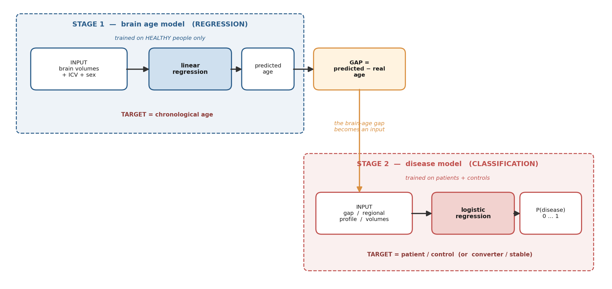
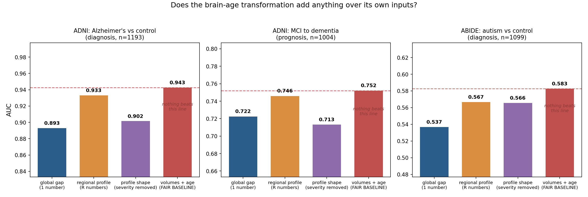

# گزارش کار انجام‌شده: معماری، آزمایش‌ها و ارزیابی سودمندی سن مغز

این گزارش به چهار پرسش پاسخ می‌دهد: دقیقاً چه کاری انجام دادیم، معماری مدل چیست و چگونه کار می‌کند، از سن مغز چه استفاده‌ای کردیم، و در نهایت این ابزار چقدر کمک کرد. برخلاف صرفِ مرور ادبیات، هر عددی که در این گزارش می‌آید حاصل اجرای واقعی روی داده‌ی واقعی است.

---

## بخش ۱: معماری — مدل دقیقاً چه کاری انجام می‌دهد؟

نخستین نکته‌ای که باید روشن شود این است که کار ما **یک مدل نیست، بلکه دو مدل پشت سر هم** است. این تمایز اهمیت زیادی دارد، زیرا اغلب سوءتفاهم‌ها از اینجا ناشی می‌شوند. به شکل ۱ دقت فرمایید.

### ۱-۱ مرحله‌ی اول: مدل سن مغز — یک مسأله‌ی رگرسیون

| مؤلفه | توضیح |
|---|---|
| **ورودی** | حجم نواحی مغز (مثلاً حجم هیپوکامپ، بطن‌ها، کل مغز)، به‌همراه حجم داخل جمجمه و جنسیت |
| **هدف آموزش (target)** | **سن تقویمی فرد** — یعنی عددی مثل ۷۲ سال |
| **نوع مسأله** | **رگرسیون** (پیش‌بینی یک عدد پیوسته)، نه طبقه‌بندی |
| **آموزش روی چه کسانی؟** | **فقط افراد سالم.** این نکته حیاتی است |
| **خروجی** | سن تخمین‌زده‌شده برای فرد |

منطق این مرحله ساده است: اگر مدل فقط روی افراد سالم آموزش ببیند، در واقع یاد می‌گیرد که «مغزِ یک فرد سالمِ ۷۲ ساله باید چه شکلی باشد». این مدل هرگز مغز بیمار نمی‌بیند.

پس از تخمین سن، یک کمیت محاسبه می‌شود:

> **شکاف سن مغز = سن تخمین‌زده‌شده − سن واقعی**

اگر مدل (که فقط با مغزهای سالم آشناست) برای فردی سنی بالاتر از سن واقعی‌اش تخمین بزند، یعنی مغز آن فرد «پیرتر از حد انتظار» به‌نظر می‌رسد. این همان سیگنالی است که امید داریم نشانه‌ی بیماری باشد.

### ۱-۲ مرحله‌ی دوم: مدل تشخیص بیماری — یک مسأله‌ی طبقه‌بندی

| مؤلفه | توضیح |
|---|---|
| **ورودی** | شکاف سن مغز (یک عدد)، یا پروفایل سنی نواحی (یک بردار)، یا حجم‌ها |
| **هدف آموزش (target)** | **برچسب بیماری** — بیمار در برابر سالم، یا تبدیل‌شونده در برابر پایدار |
| **نوع مسأله** | **طبقه‌بندی** (پیش‌بینی یک برچسب) |
| **آموزش روی چه کسانی؟** | هم بیماران و هم افراد سالم |
| **خروجی** | احتمال ابتلا به بیماری (عددی بین صفر و یک) |

پس پاسخ صریح به پرسش شما: **مرحله‌ی اول رگرسیون است و مرحله‌ی دوم طبقه‌بندی.** سن مغز خودش یک عدد پیوسته است (رگرسیون)، اما وقتی از آن برای تشخیص بیماری استفاده می‌کنیم، وارد یک مسأله‌ی طبقه‌بندی می‌شویم.

### ۱-۳ چرا این معماری هوشمندانه است؟

زیبایی این طراحی در آن است که مرحله‌ی اول به **هیچ داده‌ی بیماری‌ای نیاز ندارد**. می‌توان مدل سن را روی ده‌ها هزار فرد سالم (که فراوان‌اند) آموزش داد و سپس آن را روی بیمارانی (که کمیاب‌اند) اعمال کرد که مدل هرگز ندیده است. این یعنی می‌توان از داده‌ی فراوانِ سلامت برای ساختن یک آشکارساز بیماری بهره برد. همین ایده بود که این حوزه را در سال ۲۰۱۰ متولد کرد.

---

## بخش ۲: آنچه انجام دادیم — چهار آزمایش

ما چهار آزمایش روی سه دیتاست واقعی و آزاد انجام دادیم. تمام محاسبات روی همین سیستم و بدون نیاز به GPU اجرا شد.

| دیتاست | تعداد | محتوا |
|---|---|---|
| OASIS-1 | ۴۳۶ فرد | مقطعی، سالم و دارای اختلال شناختی |
| OASIS-2 | ۱۵۰ فرد، ۳۷۳ جلسه | طولی، شامل ۱۴ فرد تبدیل‌شونده به دمانس |
| ADNI | ۲٬۴۳۰ فرد، ۱۶٬۴۲۱ جلسه | ۶ ناحیه‌ی مغزی، شامل ۳۷۹ فرد تبدیل‌شونده |
| ABIDE | ۱٬۱۰۳ فرد | ۳۲ ناحیه‌ی مغزی، اوتیسم در برابر سالم، سنین ۶ تا ۶۴ |

نکته‌ی مهم درباره‌ی ABIDE این است که داده‌ی جدولی آن به‌صورت آماده وجود نداشت؛ ما آن را از روی فایل‌های خام FreeSurfer در فضای ابری عمومی این پروژه استخراج و پردازش کردیم (۱٬۱۰۳ فرد). افزودن اوتیسم به کار، به ما اجازه داد یافته‌ها را روی بیماری‌ای کاملاً متفاوت و در بازه‌ی سنی کاملاً متفاوت (کودکان و نوجوانان، نه سالمندان) بیازماییم.

---

## بخش ۳: چگونه از سن مغز استفاده کردیم و چقدر کمک کرد؟

### ۳-۱ آزمایش اول: آیا اصلاً کار می‌کند؟ (بازتولید)

نخست باید مطمئن می‌شدیم که پیاده‌سازی ما درست است. مدل سن مغز را روی افراد سالم OASIS آموزش دادیم و روی بیماران اعمال کردیم.

- تخمین سن در افراد سالم: همبستگی **۰٫۷۸**، خطای **۶٫۹ سال**.
- شکاف سن مغز در بیماران (پس از تطبیق سنی): **۵٫۸۳+ سال** پیرتر از افراد سالم.

**چقدر کمک کرد؟** این مرحله ثابت کرد که ابزار کار می‌کند. مدلی که هرگز مغز بیمار ندیده بود، توانست بیماران را حدود شش سال پیرتر تخمین بزند. این دقیقاً همان یافته‌ی بنیادین حوزه (Franke, 2010) است که ما آن را روی داده‌ی آزاد و یک لپ‌تاپ معمولی بازتولید کردیم.

### ۳-۲ آزمایش دوم: آیا از یک اندازه‌گیری ساده بهتر است؟

این پرسش کلیدی است. شکاف سن مغز بیماران را از سالم‌ها جدا می‌کند — اما آیا این کار را بهتر از صرفاً اندازه‌گیری حجم مغز انجام می‌دهد؟

| معیار | AUC (تشخیص بیماری) |
|---|---|
| شکاف سن مغز | ۰٫۷۰۹ |
| حجم مغز، به‌تنهایی | ۰٫۶۹۶ |
| سن تقویمی | ۰٫۵۰۷ |

اختلاف میان این دو تنها ۰٫۰۱۲ با p برابر با ۰٫۶۵ بود.

**چقدر کمک کرد؟** در این آزمایش، سن مغز **کمک اضافه‌ای نکرد**. تمام فرآیند آموزش مدل و محاسبه‌ی شکاف، چیزی بیش از یک اندازه‌گیری ساده‌ی حجم مغز به ما نداد.

### ۳-۳ آزمایش سوم: آیا تغییر هدف آموزش کمک می‌کند؟

طراحی کردیم که به‌جای پیش‌بینی سن، مدل مستقیماً زمان تا تبدیل به دمانس را پیش‌بینی کند (با مدل Cox و در نظر گرفتن سانسور داده). چهار مدل با ورودی و داده‌ی یکسان ساختیم که فقط در هدف آموزش تفاوت داشتند. معیار ارزیابی، شاخص همخوانی (C-index) بود.

| مدل | C-index |
|---|---|
| حجم مغز به‌تنهایی | **۰٫۶۲۸** |
| هدف: سن تقویمی (شکاف سن مغز) | ۰٫۵۱۳ |
| هدف: زمان تا تبدیل (Cox) | ۰٫۵۱۸ |
| آموزش مستقیم روی بیماری | ۰٫۵۲۹ |

**چقدر کمک کرد؟** با ۱۵ رویداد تبدیل، تفاوت میان هدف‌ها قابل تشخیص نبود. اما یافته‌ی مهم این بود که **باز هم هیچ مدل آموزش‌دیده‌ای از حجم ساده‌ی مغز بهتر عمل نکرد**.

### ۳-۴ آزمایش چهارم: آزمون کنترلی که کسی انجام نمی‌دهد

این مهم‌ترین و بدیع‌ترین کار ماست. ادبیات جدید به سمت «پروفایل سنی نواحی مغز» (به‌جای یک عدد واحد) رفته است. اما یک نکته‌ی منطقی وجود دارد که نادیده گرفته می‌شود:

> سن مغزِ هر ناحیه، **از روی حجم همان ناحیه و سن تقویمی** محاسبه می‌شود. پس این پروفایل نمی‌تواند اطلاعاتی داشته باشد که در ورودی‌هایش وجود ندارد؛ فقط همان اطلاعات را به شکل دیگری بازنویسی می‌کند.

بنابراین معیار مقایسه‌ی منصفانه، **«حجم‌ها + سن»** است، نه «حجم‌ها به‌تنهایی». اما مقالات معمولاً پروفایل سنی را با حجم‌های بدون سن مقایسه می‌کنند و به این ترتیب یک مزیت ناعادلانه به سن مغز می‌دهند (چون شکاف، سن را از راه پنهان وارد می‌کند).

ما این مقایسه‌ی منصفانه را روی سه وظیفه و دو بیماری اجرا کردیم. به شکل ۲ دقت فرمایید.

| وظیفه | شکاف کلی | پروفایل نواحی | فقط شکلِ پروفایل | **حجم + سن** |
|---|---|---|---|---|
| آلزایمر در برابر سالم (تشخیص) | ۰٫۸۹۳ | ۰٫۹۳۳ | ۰٫۹۰۲ | **۰٫۹۴۳** |
| تبدیل MCI به دمانس (پیش‌آگهی) | ۰٫۷۲۲ | ۰٫۷۴۶ | ۰٫۷۱۳ | **۰٫۷۵۲** |
| اوتیسم در برابر سالم (تشخیص) | ۰٫۵۳۷ | ۰٫۵۶۷ | ۰٫۵۶۶ | **۰٫۵۸۳** |

از این آزمایش دو یافته‌ی مستقل و هر بار تکرارشده (p<0.001) به‌دست آمد:

**یافته‌ی اول — فشرده‌سازی هزینه دارد.** رفتن از یک عدد (شکاف کلی) به یک بردار (پروفایل نواحی) هر بار AUC را حدود ۰٫۰۲ تا ۰٫۰۴ بهبود می‌دهد. یعنی خلاصه‌کردن مغز در یک عدد، واقعاً اطلاعات را از بین می‌برد.

**یافته‌ی دوم — اما تبدیلِ سن مغز هرگز از ورودی خودش بهتر نیست.** در هیچ‌یک از سه وظیفه، هیچ نمایشی از سن مغز نتوانست از معیار «حجم + سن» عبور کند. این حتی در پیش‌آگهی (تبدیل MCI به دمانس، که مهم‌ترین وظیفه‌ی بالینی است) و در بیماری‌ای کاملاً متفاوت (اوتیسم) نیز صادق بود.

**یک یافته‌ی جانبی جالب.** در آلزایمر، حتی وقتی شدت کلی را حذف کردیم و فقط «شکل» پروفایل باقی ماند، AUC همچنان ۰٫۹۰۲ بود؛ یعنی الگوی فضایی پیری مغز به‌تنهایی تشخیصی است. اما در اوتیسم، شکل و پروفایل کامل تقریباً برابر بودند (۰٫۵۶۶ در برابر ۰٫۵۶۷)؛ یعنی محور شدت وجود ندارد. **این دو بیماری هندسه‌ی متفاوتی در پیری مغز دارند** و این خودش یافته‌ای است که انتظارش را نداشتیم.

---

## بخش ۴: جمع‌بندی — سن مغز چقدر کمک کرد؟

پاسخ صادقانه و در یک نگاه:

| پرسش | پاسخ ما بر اساس آزمایش |
|---|---|
| آیا سن مغز کار می‌کند؟ | بله. بیماران را ~۶ سال پیرتر تخمین می‌زند |
| آیا از حجم ساده‌ی مغز بهتر است؟ | خیر (در تشخیص، پیش‌آگهی، و هر دو بیماری) |
| آیا پروفایل نواحی از یک عدد بهتر است؟ | بله، اما باز هم نه بهتر از «حجم + سن» |
| آیا تغییر هدف آموزش کمک کرد؟ | در این مقیاس قابل تشخیص نبود |

نتیجه این نیست که سن مغز بی‌فایده است. نتیجه این است که **به‌عنوان یک ابزارِ صرفاً افزایش‌دهنده‌ی دقتِ تشخیص، ارزش افزوده‌ای بر اندازه‌گیری‌های ساده ندارد** — و این را ما با آزمایش خودمان و روی داده‌ی واقعی نشان دادیم، نه صرفاً با استناد به دیگران. ارزش واقعی سن مغز باید جای دیگری باشد: در تفسیرپذیری، در قابلیت انتقال میان جمعیت‌ها، در ارتباط با پیامدهای بالینی، و در قابل‌فهم بودن برای پزشک و بیمار. این‌ها همان جهت‌هایی هستند که کار آینده باید بر آن‌ها متمرکز شود.

---

## بخش ۵: محدودیت‌ها

۱. ویژگی‌های مورد استفاده در آزمایش‌های OASIS تنها سه عدد بودند و در ADNI شش ناحیه. با تعداد نواحی بیشتر (مثلاً ۱۰۰ ناحیه‌ی کامل FreeSurfer) ممکن است پروفایل نواحی به معیار منصفانه نزدیک‌تر شود؛ این یک تهدید واقعی برای یافته‌ی دوم است و باید در گام بعدی آزموده شود.
۲. تعداد رویدادهای تبدیل در OASIS-2 تنها ۱۴ تا ۱۵ نفر بود. آزمایش سوم از این نظر کم‌توان است.
۳. تمام ویژگی‌ها حجمی هستند و از تصویر خام استفاده نشده است. مدل‌های عمیق روی تصویر ممکن است رفتار متفاوتی نشان دهند، هرچند نتایج بخش ۳-۴ نشان می‌دهد که سیگنال اصلی در همین حجم‌ها نهفته است.
۴. در آزمایش اوتیسم، AUC همه‌ی روش‌ها پایین بود (حدود ۰٫۵۸)؛ یعنی حجم‌های زیرقشری به‌تنهایی برای تشخیص اوتیسم ضعیف‌اند. این خودش یافته‌ای واقعی است اما قدرت مقایسه را محدود می‌کند.

---

## بخش ۶: کد و بازتولیدپذیری

تمام آزمایش‌ها با کد موجود در پوشه‌ی `pilot` و داده‌های پوشه‌ی `data` قابل بازتولید است:

| فایل | آزمایش |
|---|---|
| `pilot_brainage.py` | بازتولید و مقایسه با حجم (بخش ۳-۱ و ۳-۲) |
| `experiment_target.py` | مقایسه‌ی هدف‌های آموزش (بخش ۳-۳) |
| `exp2_regional.py` | آزمون کنترلی روی ADNI و ABIDE (بخش ۳-۴) |
| `exp3_prognosis.py` | آزمون کنترلی روی پیش‌آگهی (بخش ۳-۴) |
| `fetch_abide_freesurfer.py` | استخراج داده‌ی ABIDE از فضای ابری |

---

## منابع

1. Franke K, Ziegler G, Klöppel S, Gaser C (2010). Estimating the age of healthy subjects from T1-weighted MRI scans using kernel methods. *NeuroImage* 50:883–892.
2. Tan TWK و همکاران (2025). Mind the gap: does brain age improve Alzheimer's disease prediction? *Human Brain Mapping* 46:e70276.
3. Schulz M-A, Siegel M, Ritter K (2025). Brain-age models with lower age prediction accuracy have higher sensitivity for disease detection. *PLOS Biology*.
4. Vidal-Piñeiro D و همکاران (2021). Individual variations in brain age relate to early-life factors more than to longitudinal brain change. *eLife* 10:e69995.
5. Popescu SG, Glocker B, Sharp DJ, Cole JH (2021). Local Brain-Age: A U-Net Model. *Frontiers in Aging Neuroscience* 13:761954.
6. Marcus DS و همکاران (2007). Open Access Series of Imaging Studies (OASIS): cross-sectional MRI data. *Journal of Cognitive Neuroscience* 19:1498–1507.
7. Di Martino A و همکاران (2014). The Autism Brain Imaging Data Exchange (ABIDE). *Molecular Psychiatry* 19:659–667.
8. Petersen RC و همکاران (2010). Alzheimer's Disease Neuroimaging Initiative (ADNI): clinical characterization. *Neurology* 74:201–209.
